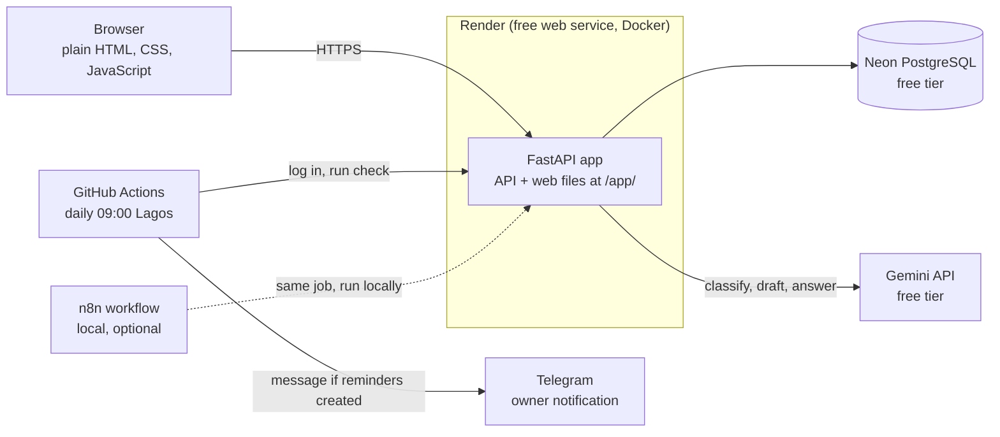

# Lumen: AI-powered business operations

Lumen helps a small business answer every customer enquiry on time. It sorts incoming enquiries, assigns them to the right person, drafts follow-up reminders for stale ones, and answers questions from the business's own saved notes.

**Live demo:** https://lumen-ty04.onrender.com/app/ (click "Try the demo"; no sign-up needed)

> The demo runs on free hosting. If nobody has visited for a while, the first visit can take about a minute to wake up.

This is a portfolio project, built as a five-day MVP.

## What it does

- **Smart sorting.** A new enquiry gets a category and a priority from an AI model. If the AI cannot decide, the enquiry is flagged "needs sorting" for a person.
- **Assignment.** Enquiries are handed to a team member. When an owner assigns one by hand, the "needs sorting" flag is cleared.
- **Follow-up reminders.** Enquiries with no activity for 2 days get a friendly draft reminder written by AI. A person always reviews it. Nothing is ever sent to a customer automatically.
- **Knowledge notes.** The owner saves notes about the business. Staff ask questions and get answers only from those notes, with the source note shown. If the notes do not contain the answer, Lumen says so.
- **Plans and usage.** Each business has a plan with an AI-call limit: Free (50) or Pro (500). Owners can switch plan on the Dashboard.
- **Demo mode.** "Try the demo" creates a private sandbox ("Sunrise Bakery (Demo)") with sample data and no real AI calls. Sandboxes are cleaned up after 24 hours.

## Architecture



**How a request flows.** The browser loads the web app from FastAPI, then calls the JSON API with a login token. Every database query is filtered by the business the user belongs to. AI calls are counted against the business's plan before they are made.

## Tech stack

| Part | Choice |
|---|---|
| Backend | Python 3.13, FastAPI, SQLAlchemy |
| Database | PostgreSQL 17 locally, Neon (free) online |
| AI | Gemini free tier (`gemini-3.5-flash-lite`) called with `httpx` |
| Frontend | Plain HTML, CSS and JavaScript in `web/`, served by FastAPI |
| Automation | GitHub Actions (live), n8n (local workflow) |
| Hosting | Render free web service, built from the `Dockerfile` |
| Tests | pytest |

Everything runs on free tiers.

## Run it locally

You need Python 3.13 and PostgreSQL.

1. Create two empty databases: `business_ops` and `business_ops_test`.
2. Create and activate a virtual environment, then install the packages:

   ```bash
   python -m venv venv
   venv\Scripts\activate          # Windows PowerShell
   pip install -r requirements.txt
   pip install -r requirements-dev.txt
   ```

3. Copy `.env.example` to `.env` and fill in your own values (database address, a long random `SECRET_KEY`, a Gemini API key). Never commit `.env`.
4. Start the app:

   ```bash
   uvicorn app.main:app --reload
   ```

5. Open the app at http://127.0.0.1:8000/app/ and the API docs at http://127.0.0.1:8000/docs.

To create the first owner account, set `ALLOW_REGISTRATION=true`, register once through `/docs`, then set it back to `false`. To try demo mode locally, set `DEMO_ENABLED=true`.

### Run the tests

```bash
pytest -q --tb=line
```

The suite has 27 tests covering login, permissions, data isolation between businesses, sorting, plans, usage limits, demo mode and database address handling.

### Docker

The `Dockerfile` is what Render builds and runs. A `docker-compose.yml` is included to start the app with its own database, but the author has not run it locally, because Docker is not installed on the development machine.

## Deployment

- **Render** builds the `Dockerfile` on every push to `master` and checks `/health` before switching to a new version.
- **Neon** holds the database. It is separate from Render because Render's own free database expires after 30 days.
- All secrets (database address, secret key, Gemini key) are environment variables set privately in Render. None is stored in this repository.
- On startup the app creates any missing tables.

### The daily follow-up job

A GitHub Actions workflow (`.github/workflows/daily-follow-ups.yml`) runs every day at 09:00 Lagos time. It logs in as the owner, calls the follow-up check, and sends a Telegram message if new reminders were created. Its credentials are stored as GitHub Secrets. It waits and retries, because the first request can hit a sleeping server.

The same job was first built as a local n8n workflow, which is kept as the visual version of the automation.

## Design decisions and trade-offs

| Decision | Why | Trade-off |
|---|---|---|
| **Registration closed by default** (`ALLOW_REGISTRATION=false`) | Strangers cannot create accounts on the live database | The first owner must be created with a temporary switch |
| **A person reviews every AI draft** | A wrong message to a customer costs more than a few seconds of review | Follow-ups are not fully automatic |
| **AI answers only from saved notes** | Stops the model from inventing business facts | If the notes are thin, the answer is "not found" |
| **Every query filtered by `business_id`** | One business can never see another's data | Needs discipline on every new endpoint, so it is covered by isolation tests |
| **Plans are enforced on the server** | The web buttons only hide options; the API refuses the rest | Plan changes are not tied to payment (see below) |
| **Demo is a private sandbox with its own AI cap** | Visitors can try everything without sign-up or cost | The demo cannot show real AI output |
| **Plain HTML, CSS and JavaScript, no framework** | Small, fast, easy to read and explain | More code to write by hand for each screen |
| **Neon separate from Render** | Avoids Render's 30-day free database expiry | Two services to manage |

### Known limits

- **There is no payment behind the plan switch.** Any owner can move themselves to Pro. A real product would put a payment provider in front of that endpoint.
- **Changing plan does not reset the used count.** An owner who drops from Pro to Free after using more than 50 calls is simply over the limit until the counter resets.
- **Registration reveals whether an email exists.** This is a deliberate simplification for an invite-only product, and it is not suitable for a public sign-up form.
- **Free hosting sleeps.** Render's free instance sleeps after 15 minutes idle and takes about a minute to wake. Neon's free database also sleeps when idle but wakes quickly.
- **Scheduled GitHub workflows can start late, and are switched off after 60 days without repository activity.**
- **The Gemini free tier has its own rate limits.**

## Security

- Passwords are hashed with bcrypt. Login tokens last 60 minutes.
- Every query is filtered by business, and owner-only endpoints are checked on the server.
- There are no fallback secrets: the app will not start without a real `SECRET_KEY`.
- A review of the code covered query filtering, owner-only checks and the password and token handling.
- No secret is stored in this repository. Settings come from environment variables, and `.gitignore` blocks `.env` files and keys.

## User acceptance testing (UAT)

Tick each box after testing it on the live site.

**Demo and access**
- [ ] "Try the demo" opens a private sandbox with sample data
- [ ] The demo works on a phone-sized window
- [ ] Registration is refused on the live site
- [ ] Logging in with the owner account works

**Screens**
- [ ] Dashboard shows the counts and the usage meter
- [ ] Enquiries: search and filters work, status and assignment can be changed
- [ ] Reminders: a draft can be copied and marked as done
- [ ] Knowledge: a question is answered from saved notes, with the source shown
- [ ] Knowledge: a question with no matching note says the answer was not found

**Rules**
- [ ] Staff cannot see owner-only buttons
- [ ] The plan switch works for the owner (Free and Pro)
- [ ] The plan switch is disabled in the demo
- [ ] One business cannot see another business's data

**Automation**
- [ ] The daily GitHub Actions job runs by hand and succeeds
- [ ] The daily job also runs by itself at 09:00
- [ ] A Telegram message arrives when new reminders are created

## Project structure

```
app/            FastAPI backend (routers, models, AI calls, usage counting)
tests/          pytest suite
web/            the web app (landing page and app screens)
.github/        the daily follow-up workflow
Dockerfile      how Render builds the app
```

## About

Built by Emmanuel as a portfolio project to practise building and deploying an AI-powered business tool end to end.